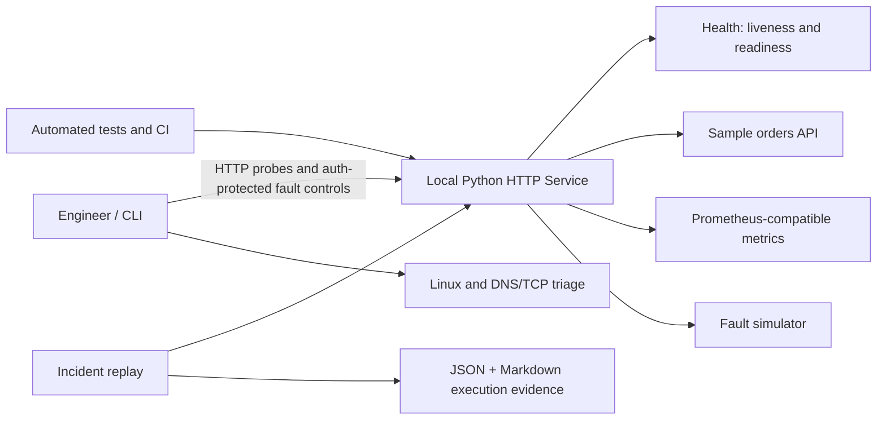

# Cloud Infrastructure Troubleshooting & Reliability Lab

**A reproducible engineering portfolio demonstrating incident investigation, fault isolation, service recovery, observability, Linux diagnostics, and safe operations.**

[](https://github.com/JamieChristian22/cloud-infrastructure-troubleshooting-lab/actions/workflows/ci.yml)


**Author:** Jamie Christian II · [GitHub profile](https://github.com/JamieChristian22) · [Portfolio](https://jamiechristian22.github.io/)

> **Evidence statement:** This project includes a real, locally executed Python service and automated tests. The incidents are **intentionally simulated using synthetic data**. They do **not** represent employer incidents, live AWS deployments, actual production SLAs, or external customer outcomes. Docker files are provided but may require validation on your machine. See [Verified vs. not yet verified](docs/verification.md).

## What an engineering recruiter can verify in five minutes

| Proof | Inspect | Why it matters |
| --- | --- | --- |
| Reproducible incident execution | [`evidence/incident-replay.md`](evidence/incident-replay.md) and [`evidence/incident-replay.json`](evidence/incident-replay.json) | Shows each injected fault, observed HTTP behavior, and recovery |
| Tests of the actual service | [`tests/test_service.py`](tests/test_service.py), [`tests/test_replay.py`](tests/test_replay.py) | Verifies availability behavior, auth controls, failure scenarios and response codes |
| Troubleshooting operations CLI | [`src/cloudops_lab/cli.py`](src/cloudops_lab/cli.py) | Demonstrates command-line incident handling and structured diagnostics |
| Runtime, health and metrics | [`src/cloudops_lab/server.py`](src/cloudops_lab/server.py) | Demonstrates HTTP reliability and observability principles |
| Local system + network triage | [`src/cloudops_lab/triage.py`](src/cloudops_lab/triage.py) | Shows Linux host data, DNS checks and TCP fault isolation |
| CI automation | [`.github/workflows/ci.yml`](.github/workflows/ci.yml) | Runs tests and four incidents on three Python versions when installed on GitHub |
| Operational documentation | [`docs/architecture.md`](docs/architecture.md) and [`docs/runbooks/`](docs/runbooks/) | Explains decisions, safety boundaries, runbooks and recovery criteria |

## Why this project exists

Cloud support and platform engineers are expected to do more than describe AWS services or draw VPC diagrams. They need to identify an alert, inspect **signals rather than guesses**, understand blast radius, find an actionable root cause, recover, and document what they learned. This lab implements a small observable order API and makes that workflow repeatable at **$0 cloud cost**.

**Career relevance:** Associate Cloud Engineer · Cloud Support Engineer · Technical Support Engineer · Application Support Engineer · Junior DevOps Engineer · Associate Platform Engineer · Junior SRE.

### Working architecture



| Component | Technology / approach |
| --- | --- |
| Service | Python 3.11+, standard-library `ThreadingHTTPServer` |
| HTTP endpoints | `/health/live`, `/health/ready`, `/api/orders`, `/metrics` |
| Faults | Dependency outage, high latency, application error, upstream auth misconfiguration |
| Security | Random fault-control token, loopback binding by default, no production data |
| Local triage | Linux disk/memory/CPU summary, DNS resolution, single-port TCP connectivity |
| Logs | JSON-formatted request events with bounded route labels and request IDs |
| Tests | Built-in `unittest`; no third-party runtime dependencies |
| Container | Rootless Docker image and local-only Compose publishing (provided; verify on your host) |
| CI | GitHub Actions 3-version matrix, incident evidence artifact upload |

## Quick start — completely free

From the root of this repository:

```bash
python --version                 # 3.11 or newer
python -m pip install -e .       # installs only this local package
python -m unittest discover -s tests -v
python -m cloudops_lab demo --output evidence
```

**Observed during initial project verification:** 19/19 automated tests passed, and 4/4 fault scenarios were injected, observed and recovered successfully. Re-run locally or inspect the CI workflow rather than assuming this reflects all platforms.

### Start and operate the service

Use **two terminal windows**. Terminal 1:

```bash
python -m cloudops_lab serve
```

Terminal 2:

```bash
python -m cloudops_lab status
python -m cloudops_lab probe --requests 3
python -m cloudops_lab inject dependency_outage
python -m cloudops_lab status
python -m cloudops_lab probe --requests 3
python -m cloudops_lab recover
python -m cloudops_lab status
```

The probe returns a nonzero exit status when the API is unhealthy: **this is expected during fault injection**. The control token is written to `.lab/control.json` (ignored by Git) with `0600` permissions; never publish it.

### Explore the service directly

```bash
curl -i http://127.0.0.1:8080/health/live
curl -i http://127.0.0.1:8080/health/ready
curl -i http://127.0.0.1:8080/api/orders
curl -s http://127.0.0.1:8080/metrics
```

### Triage local host and network

```bash
python -m cloudops_lab linux
python -m cloudops_lab network --host localhost --port 8080
```

Read-only triage collects only local host characteristics and checks exactly **one host and port**. Do not use this project for unauthorized network probing.

## Supported, executable incidents

| # | Scenario | Service symptom | Expected on API | Recovery |
| --- | --- | --- | --- | --- |
| 01 | [Dependency outage](docs/runbooks/01-dependency-outage.md) | Readiness fails; liveness continues | HTTP 503 | Clear fault, recheck readiness + requests |
| 02 | [High latency](docs/runbooks/02-high-latency.md) | Slow order requests | HTTP 200, ~300ms injected delay | Restore normal response time |
| 03 | [Application error](docs/runbooks/03-application-error.md) | Request fails, health may remain up | HTTP 500 | Restore successful API response |
| 04 | [Upstream auth misconfiguration](docs/runbooks/04-auth-misconfig.md) | API cannot authenticate to simulated upstream | HTTP 401 | Reset fault and verify request |

The fault emulator is deliberately scoped to a local service; it does not actually break AWS networking, credentials, a real database, or an external dependency. The meaningful engineering work is **signal interpretation, diagnosis, controls and verified recovery**.

### Additional investigation exercises

- [05 · Linux system triage](docs/runbooks/05-linux-triage.md): Disk, memory, processes, journal and service status concepts.
- [06 · DNS and TCP triage](docs/runbooks/06-network-triage.md): Resolve a hostname, isolate DNS vs TCP vs HTTP failures.

## Repository layout

```text
cloud-infrastructure-troubleshooting-lab/
├── .github/workflows/ci.yml       # Test matrix + generated incident evidence
├── src/cloudops_lab/              # Service, CLI, faults, metrics and diagnosis
├── tests/                         # Unit + HTTP integration + replay verification
├── evidence/                      # Locally generated synthetic incident artifacts
├── docs/
│   ├── runbooks/                  # Four executable scenarios + two triage labs
│   ├── architecture.md
│   ├── verification.md
│   ├── incident-report-template.md
│   └── career-interview-guide.md
├── infra/Dockerfile               # Non-root local container configuration
├── compose.yaml                   # Localhost-only exposure
├── pyproject.toml
└── README.md
```

## Engineering decisions and tradeoffs

**Why no external dependencies?** A new engineer should be able to clone this and run useful incidents without signing up for an AWS account or paying for infrastructure. The standard library also keeps the failure surface observable and inspectable.

**Why separate liveness from readiness?** A process can stay alive while an upstream service is unusable. The dependency-outage scenario demonstrates this distinction: liveness remains 200 while readiness becomes 503.

**Why fail injection is authenticated?** Operations endpoints change runtime behavior. A per-launch, randomly generated local token and default loopback-only binding reduce accidental misuse. This **is not production-grade access management**.

**Why synthetic incident data?** Reproducibility and professional honesty. All results can be re-created, without claiming performance improvements or access to employer systems.

## Next engineering milestones — not yet implemented

See [`docs/roadmap.md`](docs/roadmap.md) for concrete completion gates: measured latency SLOs, a real dependency with graceful degradation, full Docker runtime validation, an instrumented dashboard, Kubernetes probe manifests, and a safely budgeted optional AWS deployment. No milestone is presented as completed without supporting evidence.

## Portfolio interview guide

See [`docs/career-interview-guide.md`](docs/career-interview-guide.md) for concise explanations of the troubleshooting methodology, tradeoffs, and honest statements about simulation vs. real production experience.

## Security, license and contributions

Do not deploy publicly. Read [`SECURITY.md`](SECURITY.md) first. Contributions welcome via [`CONTRIBUTING.md`](CONTRIBUTING.md). MIT licensed.