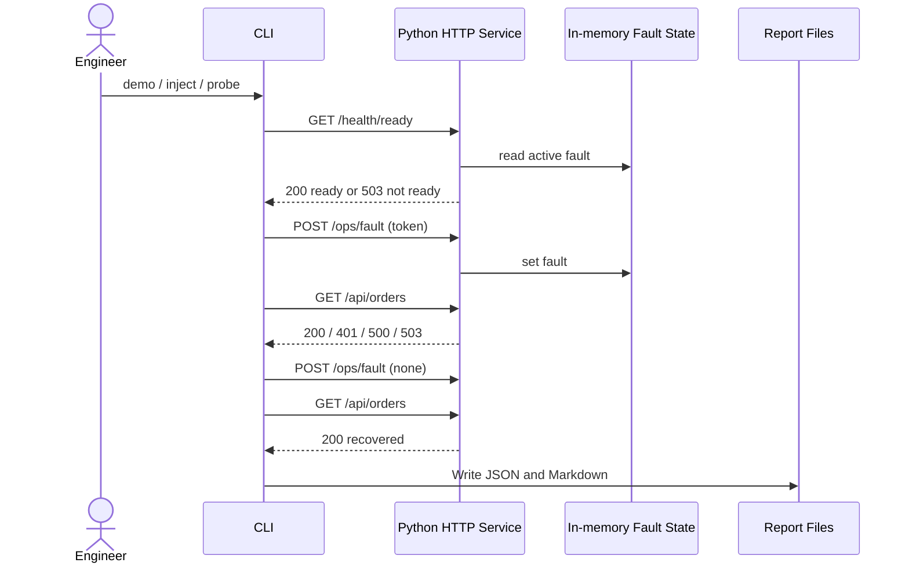

# Architecture and engineering decisions

## Problem statement

A junior cloud or application engineer needs repeatable evidence of troubleshooting a service that can appear healthy while downstream operations fail. This local lab supports fault injection, time correlation, recovery verification, and inspectable evidence without a cloud account.

## Logical topology

## Operational signals

| Signal | Collection | Interpretation | Limitation |
| --- | --- | --- | --- |
| Liveness | `GET /health/live` | Process and handler reachable | Not proof upstream data is available |
| Readiness | `GET /health/ready` | Simulated dependency usable | No actual database call |
| Error rate | `lab_requests_total` by status | Determine what fraction fails | Process-local; resets on restart |
| Latency | `lab_request_duration_seconds_sum/count` | Mean request duration | No histogram/percentile instrumentation yet |
| Fault state | `lab_fault_active` | Incident currently injected | Lab simulation only |
| HTTP request IDs | `X-Request-ID` + JSON event logs | Support correlation | Not distributed tracing |

## Failure taxonomy

1. **503 dependency unavailable:** liveness healthy, readiness unhealthy, and API fails.
2. **Slow but 200:** readiness healthy but response times regress, so errors alone will miss the incident.
3. **500 application failure:** a request path breaks while health checks continue serving.
4. **401 authentication misconfiguration:** a simulated upstream identity failure, not an authentication bypass.

## Fault-control boundaries

- Default bind: `127.0.0.1`; non-loopback binding requires explicit opt-in.
- `/ops/fault` and `/ops/state` require a randomly generated token.
- Local token file uses mode `0600`; `.lab/` is gitignored.
- Faults exist only in memory and clear on restart.
- Metrics use fixed low-cardinality route labels; query parameters aren't logged.
- This server is not internet-facing production software: it has no TLS, durable metrics backend, or rate limiting.

## Implementation scope

**Verified locally:** Python service and CLI; fault flows, metrics, tests, Linux diagnostics, DNS/TCP checks, and four incident replays.

**Configured, awaiting external runtime verification:** Dockerfile, Compose, hosted GitHub Actions jobs.

**Not implemented:** AWS provisioning, Terraform deployment, Kubernetes, durable storage, external alerting, distributed tracing, cloud billing telemetry.

## Next engineering steps

Add real local dependencies, latency histograms, bounded retries with tests, Prometheus and Grafana local-only monitoring, and evidence-backed deployment/rollback.
